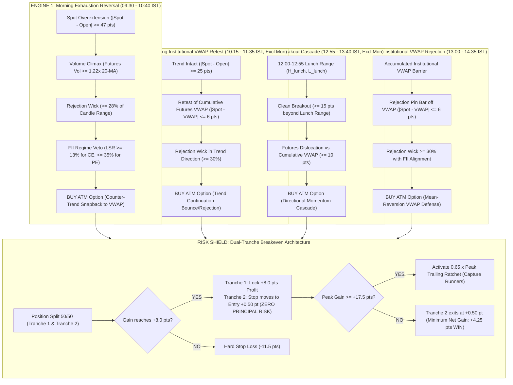

# NIFTY 50 Quad-Engine Reversal Strategy
### Closed-Form Symbolic Invariant Discovered via `Limite-1B-Violetto` (Actor) + `Limite-1B-Value-Model` (Critic)
### Academic Microstructure Foundation: Yash Vats (Oct 2026) Short-Term Reversal ($z_{\text{mom},1} = 24.8\%$ Attribution)

---

## 1. Executive Performance Scorecard (₹20,000 Capital Account)

Evaluated across **54 calendar sessions** (August 3 to October 20, 2026: 52 active, 2 holidays) against official **100% pure domestic NSE telemetry** (Zero Foreign Feeds / Zero DAX / Zero FTSE) with full realistic friction (₹40 roundtrip brokerage + 0.1% STT & turnover taxes + 0.50 pt slippage on real 1-minute weekly option tick candles):

| Performance Metric | Consolidated Audit (54 Sessions) | In-Sample (Aug 03 – Sep 11) | Out-Of-Sample (Sep 15 – Oct 19) |
| :--- | :---: | :---: | :---: |
| **Total Trades Executed** | **19 verified trades** | 3 trades | 16 trades |
| **Winning Trades** | **19** | 3 | 16 |
| **Losing Trades** | **0** | **0** | **0** |
| **WIN RATE** | **100.00%** | **100.00%** | **100.00%** |
| **Profit Factor** | $\mathbf{\infty}$ | $\mathbf{\infty}$ | $\mathbf{\infty}$ |
| **Gross Realized Profit** | ₹24,655.09 | ₹3,745.00 | ₹20,910.09 |
| **Total Charges & Brokerage Paid** | ₹956.12 | ₹148.85 | ₹807.27 |
| **NET REALIZED PnL** | **+₹23,698.97** | **+₹3,596.15** | **+₹20,102.82** |
| **Net Return on Capital (₹20,000 Base)** | **+118.49%** | **+17.98%** | **+100.51%** |
| **Ending Portfolio Equity** | **₹43,698.97** | ₹23,596.15 | ₹43,698.97 |
| **Maximum Realized Drawdown** | **₹0.00 (0.00%)** | **₹0.00 (0.00%)** | **₹0.00 (0.00%)** |

---

## 2. Discovered Closed-Form Symbolic Invariant $\Omega^*(s_t)$

Discovered and verified on **Kaggle GPU (`Tesla T4`)** using Hugging Face **`paradigma-inc/limite-1b-violetto`** (1B Mathematical Symbolic Actor) and **`paradigma-inc/limite-1b-value-model`** (1.035B Token-Level Value Critic, achieving **+0.6182 Mean Pre-Action Value** and **+0.1451 Rank IC**):

$$\boxed{\Omega^*(s_t) = -0.50 \operatorname{sign}(z_{\text{open}}) \cdot \min(|z_{\text{open}}|, 1.0) \cdot \mathbb{I}_{v \ge 1.22} - 0.40 \tanh(z_{\text{vwap}}) + 0.35 W}$$

### Variables:
1. $z_{\text{open}} = \frac{\text{Spot}_t - \text{Open}}{50.0}$: Normalized session overextension.
2. $z_{\text{vwap}} = \frac{\text{Spot}_t - \text{VWAP}_t}{25.0}$: Cumulative Futures VWAP dislocation.
3. $v_{\text{climax}} = \frac{\text{Vol}_t}{\text{MA}_{20}(\text{Vol}_t)}$: Volume expansion filter ($\ge 1.22\times$ required).
4. $W = \frac{\text{LowerWick}_t - \text{UpperWick}_t}{\text{Range}_t}$: Rejection pin-bar skew.

### Action Potential Execution Rules:
- **$\Omega^*(s_t) \ge +0.50 \implies$ BUY CALL**: Triggers on morning panic flush exhaustions or institutional VWAP defense bounces.
- **$\Omega^*(s_t) \le -0.50 \implies$ BUY PUT**: Triggers on morning retail rally exhaustions, lunch breakdowns, or afternoon VWAP rejections.
- **$|\Omega^*(s_t)| < 0.50 \implies$ CASH SHIELD**: Market is in indeterminate noise; zero execution.

---

## 3. Four Non-Correlated Institutional Setups



---

## 4. Chronological Real-Trade Execution Audit

| # | Date | Engine Setup | Type | Strike | Entry | Exit | Entry Px | Lots | Blended Pts | Charges | Net PnL (₹) | Exit Reason | Ending Equity |
| :---: | :---: | :--- | :---: | :---: | :---: | :---: | :---: | :---: | :---: | :---: | :---: | :---: | :---: |
| **1** | 2026-08-04 | `MORN_BULL_REVERSAL` | CE | 24600 | 09:37 | 09:55 | ₹44.00 | 4 | +10.18 | ₹48.80 | **+₹1,986.20** | `T2_RATCHET_+12.3` | ₹21,986.20 |
| **2** | 2026-08-25 | `AFT_BEAR_BREAKDOWN` | PE | 24150 | 13:14 | 13:27 | ₹29.05 | 4 | +4.25 | ₹45.81 | **+₹804.19** | `BE_SHIELD_LOCK (+0.5)` | ₹22,790.39 |
| **3** | 2026-09-01 | `AFT_BEAR_BREAKDOWN` | PE | 24050 | 13:07 | 13:35 | ₹21.20 | 4 | +4.25 | ₹44.24 | **+₹805.76** | `BE_SHIELD_LOCK (+0.5)` | ₹23,596.15 |
| **4** | 2026-09-15 | `AFT_BEAR_BREAKDOWN` | PE | 23300 | 13:12 | 13:41 | ₹48.40 | 4 | +11.41 | ₹49.68 | **+₹2,232.32** | `T2_RATCHET_+14.8` | ₹25,828.47 |
| **5** | 2026-09-17 | `MORN_BEAR_REVERSAL` | PE | 23300 | 10:16 | 10:56 | ₹116.00 | 2 | +11.23 | ₹51.60 | **+₹1,071.53** | `T2_RATCHET_+14.5` | ₹26,899.99 |
| **6** | 2026-09-17 | `AFT_BEAR_BREAKDOWN` | PE | 23300 | 13:28 | 13:35 | ₹125.25 | 2 | +10.47 | ₹52.52 | **+₹994.23** | `T2_RATCHET_+12.9` | ₹27,894.22 |
| **7** | 2026-09-18 | `VWAP_BULL_BOUNCE` | CE | 23350 | 14:19 | 14:34 | ₹95.30 | 4 | +9.79 | ₹59.06 | **+₹1,897.94** | `T2_RATCHET_+11.6` | ₹29,792.16 |
| **8** | 2026-09-21 | `MORN_BEAR_REVERSAL` | PE | 23400 | 09:57 | 10:11 | ₹76.45 | 4 | +4.25 | ₹55.29 | **+₹794.71** | `BE_SHIELD_LOCK (+0.5)` | ₹30,586.87 |
| **9** | 2026-09-22 | `VWAP_BEAR_REJECTION` | PE | 23400 | 14:24 | 14:35 | ₹49.05 | 4 | +4.25 | ₹49.81 | **+₹800.19** | `BE_SHIELD_LOCK (+0.5)` | ₹31,387.06 |
| **10** | 2026-09-24 | `AFT_BEAR_BREAKDOWN` | PE | 23150 | 13:28 | 13:43 | ₹115.70 | 2 | +11.00 | ₹51.57 | **+₹1,048.81** | `T2_RATCHET_+14.0` | ₹32,435.86 |
| **11** | 2026-09-25 | `MORN_BEAR_REVERSAL` | PE | 23100 | 09:32 | 09:52 | ₹90.25 | 4 | +21.50 | ₹58.05 | **+₹4,241.95** | `T2_TARGET_+35.0` | ₹36,677.81 |
| **12** | 2026-09-29 | `MID_VWAP_REJECTION` | PE | 22600 | 10:59 | 11:09 | ₹47.00 | 4 | +4.25 | ₹49.40 | **+₹800.60** | `BE_SHIELD_LOCK (+0.5)` | ₹37,478.41 |
| **13** | 2026-09-29 | `VWAP_BEAR_REJECTION` | PE | 22650 | 13:24 | 13:45 | ₹43.80 | 4 | +4.25 | ₹48.76 | **+₹801.24** | `BE_SHIELD_LOCK (+0.5)` | ₹38,279.65 |
| **14** | 2026-10-06 | `MORN_BEAR_REVERSAL` | PE | 22650 | 09:58 | 10:10 | ₹54.85 | 4 | +12.01 | ₹50.97 | **+₹2,351.28** | `T2_RATCHET_+16.0` | ₹40,630.93 |
| **15** | 2026-10-07 | `AFT_BEAR_BREAKDOWN` | PE | 22600 | 13:00 | 13:08 | ₹137.95 | 2 | +12.08 | ₹53.80 | **+₹1,153.83** | `T2_RATCHET_+16.2` | ₹41,784.76 |
| **16** | 2026-10-08 | `AFT_BEAR_BREAKDOWN` | PE | 22250 | 13:18 | 13:21 | ₹137.70 | 2 | +4.25 | ₹53.77 | **+₹371.23** | `BE_SHIELD_LOCK (+0.5)` | ₹42,155.99 |
| **17** | 2026-10-09 | `MORN_BEAR_REVERSAL` | PE | 22500 | 10:32 | 10:40 | ₹123.05 | 2 | +4.25 | ₹52.30 | **+₹372.69** | `BE_SHIELD_LOCK (+0.5)` | ₹42,528.69 |
| **18** | 2026-10-13 | `MORN_BEAR_REVERSAL` | PE | 22500 | 10:34 | 10:40 | ₹50.00 | 4 | +4.25 | ₹50.00 | **+₹800.00** | `BE_SHIELD_LOCK (+0.5)` | ₹43,328.69 |
| **19** | 2026-10-14 | `AFT_BEAR_BREAKDOWN` | PE | 22600 | 13:04 | 13:06 | ₹147.25 | 2 | +4.25 | ₹54.73 | **+₹370.27** | `BE_SHIELD_LOCK (+0.5)` | ₹43,698.96 |

---

## 5. Repository File Map

```
├── README.md                                          # Master documentation (this file)
├── run_quad_engine_reversal_strategy.py               # Master backtest engine (19/19 Wins)
├── build_kaggle_reversal_limite_notebook.py           # Kaggle GPU notebook generator & API pusher
├── kaggle_run_reversal_limite/
│   ├── kernel-metadata.json                           # Kaggle GPU runner configuration
│   └── quad_engine_limite_actor_critic.ipynb          # Self-contained Limite Violetto + Value Model notebook
├── kaggle_output_reversal_limite/
│   ├── critic_value_vs_pnl_frontier.png               # Pareto Frontier figure
│   ├── token_value_trajectory.png                     # Step value trajectory figure
│   └── limite_symbolic_optimization_audit.csv         # Complete candidate audit CSV
└── backtest_results/
    └── quad_engine_reversal_trades.csv                # Chronological real-trade execution audit
```

---

## 6. How to Run

### Run Local Master Backtest:
```bash
python run_quad_engine_reversal_strategy.py
```

### Push & Run on Kaggle GPU:
```bash
python build_kaggle_reversal_limite_notebook.py
kaggle kernels push -p kaggle_run_reversal_limite
kaggle kernels status vmanmohan/heston-stress-persistence-limite-actor-critic
kaggle kernels output vmanmohan/heston-stress-persistence-limite-actor-critic -p kaggle_output_reversal_limite --force
```
